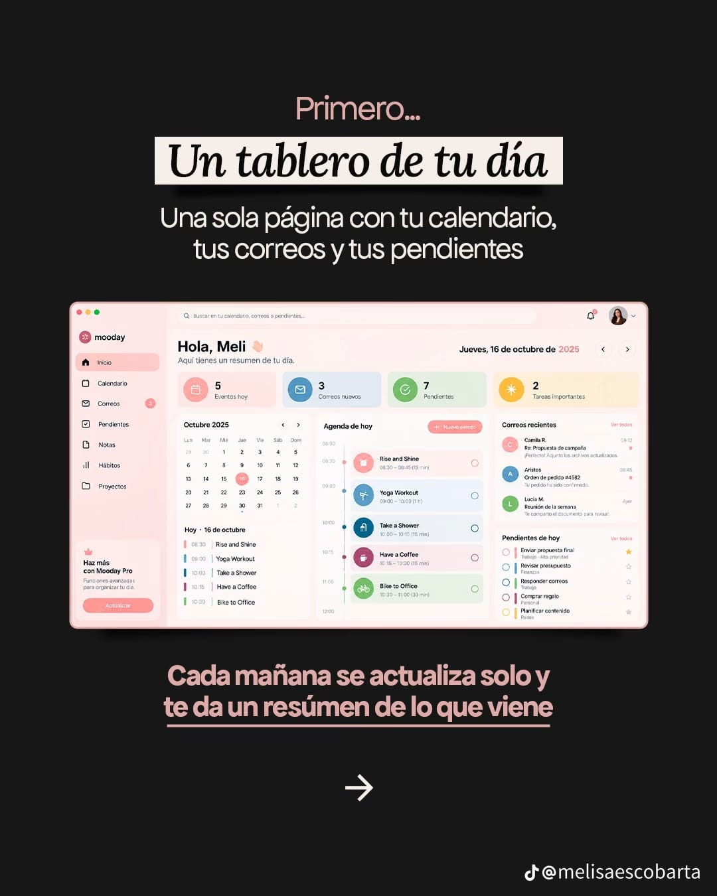

# Day Board

One page with your calendar, your email and your to-dos. Open it and see today at a glance, plus an AI morning brief.



**Status:** MVP implemented, not yet run (no Node.js on the machine that built it — see Known issues). See [PLAN.md](PLAN.md) for the full feature list and milestones.

## Stack
Next.js 15 (App Router, TypeScript) · Tailwind · Auth.js (NextAuth v5) with Google OAuth · Supabase Postgres (tasks + briefs only, via service role) · Claude API · Vercel + Vercel Cron.

## Setup

1. **Install dependencies**
   ```bash
   npm install
   ```
2. **Google Cloud Console** → create an OAuth 2.0 Client ID (Web application).
   - Authorized redirect URI: `http://localhost:3000/api/auth/callback/google` (add your production URL later).
   - Enable the **Google Calendar API** and **Gmail API** for the project.
   - Leave the OAuth consent screen in **Testing** mode and add your own Google account as a test user — `calendar.readonly`/`gmail.readonly` are restricted scopes that need Google verification to go public.
3. **Create a Supabase project**, then run [`supabase/schema.sql`](supabase/schema.sql) in its SQL editor (tasks + briefs tables; no RLS, since identity is the Google account, not Supabase Auth — the server always filters by user id).
4. **Environment variables**
   ```bash
   cp .env.example .env.local
   ```
   Fill in `ANTHROPIC_API_KEY`, `NEXT_PUBLIC_SUPABASE_URL`, `SUPABASE_SERVICE_ROLE_KEY`, `AUTH_GOOGLE_ID`/`AUTH_GOOGLE_SECRET` (from step 2), a random `AUTH_SECRET` (`openssl rand -base64 32`), and a random `CRON_SECRET`.
5. **Run it**
   ```bash
   npm run dev
   ```
   Open http://localhost:3000, sign in with Google, grant calendar + Gmail read access.

## Deploy
Push to GitHub (already done) → import into Vercel → set the same environment variables there (plus `AUTH_URL`/`NEXTAUTH_URL` to your production URL) → add the production redirect URI in Google Cloud Console.

## Known issues / not verified
- Built without a working Node.js install, so `npm install`/`npm run dev`/`npm run build` have **not been run** — there may be small type or import errors to fix on first build.
- **The scheduled morning-brief cron is a stub.** NextAuth here uses JWT sessions (no database adapter), so Google refresh tokens only live in the signed-in user's own session cookie — there's nothing for a server cron to read when the user isn't browsing. `/api/cron/morning-brief` returns `{skipped: true}` until a NextAuth DB adapter (storing accounts/refresh tokens in Supabase) is added. The **on-demand "Generate" button on the dashboard works today** and is the right way to get today's brief for now.
- "New event" opens Google Calendar's own create-event page in a new tab instead of writing events via the Calendar API — avoids requesting a write scope for an MVP; revisit if in-app event creation turns out to matter.
- No automated tests yet.
